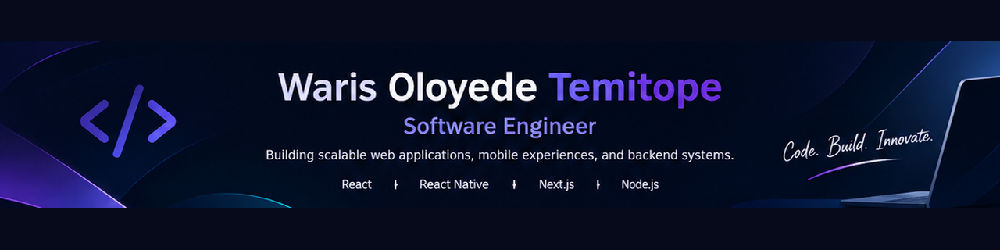

# 👋 Hi, I'm Waris Oloyede Temitope!

I'm a **Software Engineer** passionate about designing and building scalable, efficient, and user-centric software solutions. I specialize in **React, React Native, Next.js, and Node.js**, with experience spanning frontend architecture, mobile application development, backend engineering, and product development.

I enjoy turning complex ideas into practical solutions, building products that solve real-world problems, and creating seamless digital experiences.

- 🔭 **What I'm Working On:** Co-founding and building **Sphere NG**, a logistics platform connecting people who need to move goods with drivers through a location- and budget-based matching system. I'm also working as a **Mobile Engineer at EstateIQ**, contributing to solutions across estate management, access control, security, billing, payments, and resident services. Additionally, I contribute to real-estate technology products at **Myxellia**, including Mainstone, Adozillion, and Doorhive.

- 💼 **Professional Experience:** 5+ years of software development experience, primarily within the React ecosystem, working across different industries and product domains. I enjoy taking ownership of engineering challenges and translating business requirements into maintainable, scalable software.

- 🎓 **Education:** B.Sc. in Computer Science with Mathematics from **Obafemi Awolowo University (OAU), Nigeria**.

- 👯 **Collaboration Interests:** Open to collaborating on impactful projects involving **React, React Native, Next.js, Node.js, TypeScript, and backend engineering**. I'm particularly interested in products that leverage technology to solve practical problems.

- 🌱 **What I'm Learning:** Continuously exploring software architecture, system design, scalable backend systems, application security, cloud infrastructure, and emerging technologies.

- ⚡ **Fun Fact:** I enjoy exploring new technologies, solving challenging engineering problems, and turning ideas into functional products. I believe great software is not just about writing code; it's about building solutions that make a difference.

---

## 🚀 Technical Skills

### 💻 Frontend Development

### 📱 Mobile Development

### ⚙️ Backend Development

### 🗄️ Databases & Data Management

### ☁️ DevOps & Cloud

### 🛠️ Development Tools

---

## 🌟 Featured Projects

### 📦 Sphere NG

A logistics platform designed to connect people who need to move goods and belongings with drivers based on location and budget.

**Focus Areas:** Logistics · Location-based Matching · Mobile Development · Payment Verification

**Technologies:** React Native · Expo · ElysiaJS · Bun

### 🏢 EstateIQ

A property and estate management ecosystem focused on simplifying estate operations and improving residents' experiences.

**Focus Areas:** Access Control · Security Management · Incident Reporting · Billing & Payments · Resident Services

**Technologies:** React Native · TypeScript · API Integration

### 🏡 Myxellia

Contributing to real-estate technology products, building modern and intuitive digital experiences for property-related services.

**Products:** Mainstone · Adozillion · Doorhive

**Technologies:** Next.js · React · TypeScript

---

## 🧠 Engineering Philosophy

I believe great software engineering goes beyond writing code. It's about understanding problems, designing thoughtful solutions, and building products that are reliable, maintainable, and scalable.

Some principles I value:

- 🏗️ **Clean Architecture:** Building maintainable, modular, and well-structured applications.
- ⚡ **Performance:** Creating fast, efficient, and responsive digital experiences.
- 🔐 **Security:** Prioritizing secure application design and data protection.
- 🧩 **Problem Solving:** Breaking complex problems into practical and effective solutions.
- 👥 **Collaboration:** Working with teams to transform ideas into meaningful products.
- 🎯 **Product Thinking:** Understanding the business and user problems behind the software we build.

---

## 🌱 Areas of Interest

- Software Architecture & System Design
- Scalable Backend Systems
- Mobile Application Engineering
- Application Security
- Cloud Infrastructure & DevOps
- AI-powered Applications
- Developer Experience & Engineering Productivity

---

## 📊 GitHub Statistics

  

  

## 🔥 Contribution Streak

  

## 📈 Contribution Activity

  

---

## 🤝 Let's Connect!

I'm always open to discussing interesting ideas, collaborating on meaningful projects, and connecting with fellow developers and technology enthusiasts.

  
  
  

---

  <i>"Build with purpose. Engineer with precision. Create with impact."</i>

  Thanks for stopping by! ⭐

